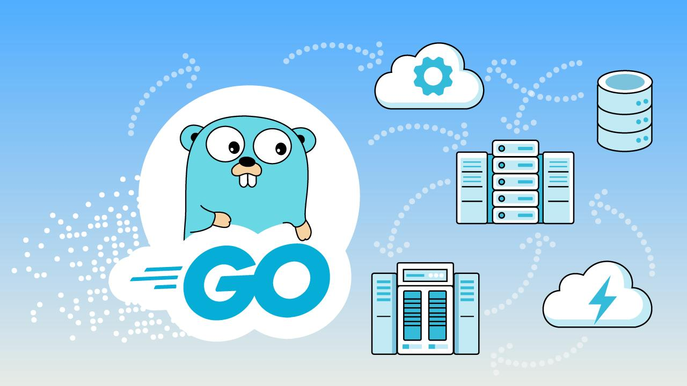
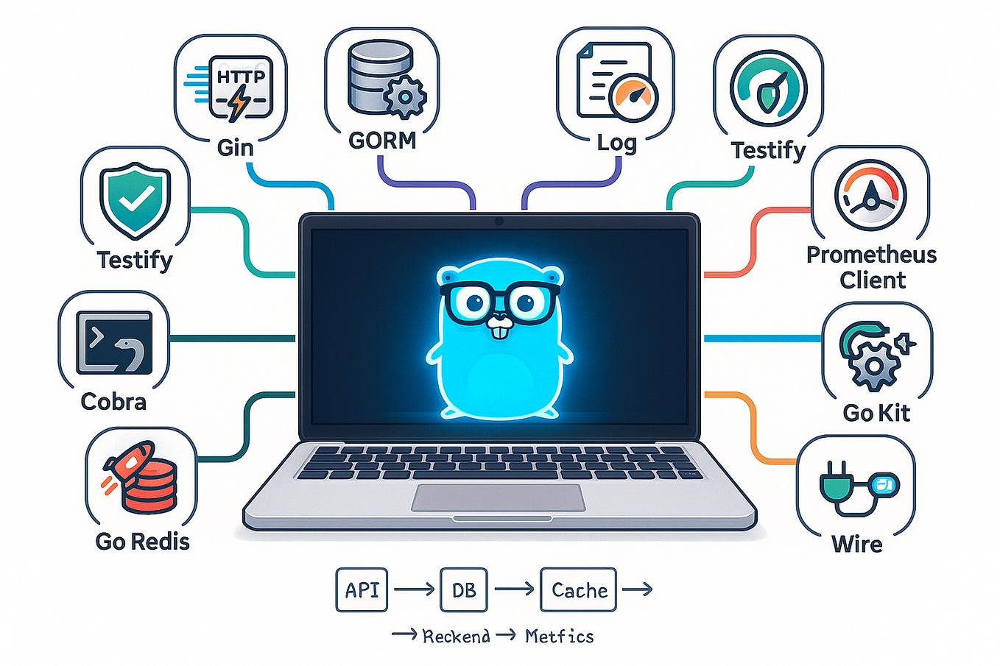

**English** | [Turkish](./README_TR.md) | [Russian](./README_RU.md)

## What is Go (Golang)?

Go is an open-source, statically typed, compiled programming language announced by Google in 2009. It was designed for building fast, simple software that handles concurrency well.

<table>
  <tr>
    <td rowspan="2"></td>
    <td></td>
  </tr>
  <tr>
    <td></td>
  </tr>
</table>

## Installing Go

Download the installer for your operating system from [go.dev/dl](https://go.dev/dl) and install it.

- **Windows:** Run the `.msi` file.
- **macOS:** Run the `.pkg` file or use `brew install go`
- **Linux:** Extract the `.tar.gz` archive into `/usr/local` and add `/usr/local/go/bin` to your PATH.

Verify:

```bash
go version
```

## First Project

```bash
mkdir hello && cd hello
go mod init hello
```

`main.go`:

```go
package main

import "fmt"

func main() {
    fmt.Println("Hello, Go!")
}
```

```bash
go run main.go
```

**Editor:** VS Code + the official Go extension

## What is Go used for?

- **Backend and REST APIs:** Authentication, CRUD and database operations.
- **Microservices:** Splitting large applications into small, independent services.
- **Cloud and DevOps:** Docker, Kubernetes and Terraform are written in Go; it is ideal for CLI tools.
- **Concurrent systems:** Handling many requests and connections at the same time.

## Advantages

- High performance
- Easy concurrency with goroutines
- Simple syntax
- Static type system
- Easy deployment as a single binary
- Strong standard library and tooling

## Disadvantages

- **Repetitive error handling:** There are no exceptions; you constantly write `if err != nil`.
- **Limited generics:** Added in 1.18, but simpler than in Java and C#.
- **No classes or inheritance:** Requires a different way of thinking if you are used to OOP.
- **Missing language features:** No enums, no ternary operator (`? :`) and no default parameters.
- **Smaller ecosystem:** Fewer ready-made libraries and frameworks than Java or Node.js.
- **Garbage collector:** For real-time and low-level systems (game engines, embedded), Rust or C++ is a better fit.
- **Weak for frontend and GUI:** Not a common choice for desktop or mobile interfaces.
- **Nil pointer errors:** Careless code can cause a runtime `panic`.

## Go vs Java vs C# vs Node.js

| Feature                | Go                         | Java                                | C#                                         | Node.js                                 |
| ---------------------- | -------------------------- | ----------------------------------- | ------------------------------------------ | --------------------------------------- |
| **Type**               | Programming language       | Programming language                | Programming language                       | JavaScript runtime                      |
| **Execution**          | Compiled machine code      | Bytecode on the JVM (JIT)           | On the .NET CLR (JIT, AOT supported)       | JavaScript on V8                        |
| **Performance**        | High                       | High, after warm-up                 | High                                       | Strong for I/O, weak for CPU-heavy work |
| **Startup time**       | Very fast                  | Slow                                | Medium                                     | Fast                                    |
| **Concurrency**        | Goroutines, channels       | Threads, virtual threads (Java 21+) | async/await, Task                          | Event loop, async/await                 |
| **Memory usage**       | Low                        | High                                | Medium                                     | Medium                                  |
| **Type system**        | Static                     | Static                              | Static                                     | Dynamic (static with TypeScript)        |
| **Syntax**             | Minimal, few keywords      | Verbose                             | Rich, feature-heavy                        | Flexible                                |
| **Learning curve**     | Easy                       | Medium–hard                         | Medium                                     | Easy if you know JavaScript             |
| **Popular frameworks** | net/http, Gin, Echo, Fiber | Spring Boot, Quarkus                | ASP.NET Core                               | Express, Fastify, NestJS                |
| **Deployment**         | Single binary              | JAR + JVM required                  | .NET runtime or self-contained             | Node.js + node_modules required         |
| **Strongest in**       | Microservices, cloud, CLI  | Enterprise systems, banking         | Enterprise systems, Windows, games (Unity) | Real-time apps, full-stack JS           |

**Summary:** Go offers simplicity and speed. Java and C# have strong ecosystems for large enterprise projects. Node.js lets you use the same language as the frontend.
